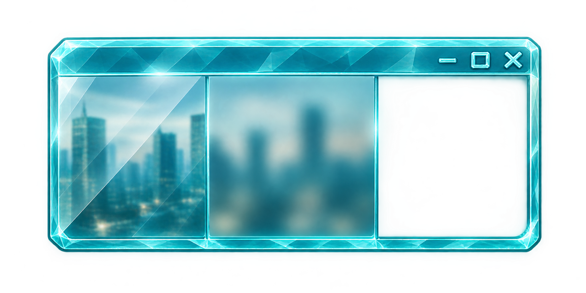

<div align="center">

  # Glass Module

  <br>

  
</div>


## Overview

A lightweight Lua module that applies modern Windows visual effects (Mica, Acrylic, Blur, Dark Mode, Rounded Corners, Border, Shadow) to any window using FFI and native Windows APIs.


_**How It Works**_<br>
The module uses LuaJIT's FFI to call the following Windows API functions:

- `SetWindowCompositionAttribute` – legacy accent effects (blur, acrylic, transparency, solid).
- `DwmSetWindowAttribute` – DWM attributes (Mica, dark mode, corners, border color, shadow).
- `DwmExtendFrameIntoClientArea` – extends the window frame over the client area, which Mica needs in order to be visible.
- `RtlGetVersion` – reads the real Windows build number (not affected by application manifests).
- `RegOpenKeyExA`, `RegQueryValueExA`, `RegCloseKey` – read the system theme for `glass.isDark()`.

Before applying new effects, an internal general reset function is always called to disable all previously defined attributes (including the border color), ensuring a clean initial state.

<br>
<br>


## :green_book: Features

> [!TIP]
> Effects can be combined (for example `effect` + `corners` + `dark` + `border`). Each call replaces the previous state, so always pass every option you want in a single call.

> [!IMPORTANT]
> **Requirements**<br>
> Windows 10/11 (some effects require specific builds – see Compatibility)

- **Mica & Mica Alt** – Windows 11 backdrop materials
- **Acrylic Blur** – Fluent Design acrylic effect (Windows 10 1803+)
- **Blur Behind** – Classic Aero-style blur (see [Why Blur May Look Like Acrylic](#why-blur-may-look-like-acrylic))
- **Transparent Gradient** – Simple transparency
- **Solid Color** – Opaque fill with optional opacity
- **Rounded Corners** – Control window corner rounding
- **Dark Mode** – Toggle immersive dark mode
- **Border** – Remove, restore, or set a custom color for the DWM border
- **Shadow** – Enable or disable the window shadow
- **Automatic fallback** – Mica falls back to Acrylic or Blur on unsupported builds
- **Theme detection** – `glass.isDark()` reports the system app theme

<br>
<br>


## :jigsaw: Example


```lua
local glass = require("glass")


-- @usage glass(hwnd, options)
-- @param (number|userdata) hwnd - a valid Windows window handle.
-- @param (table) options – a table with the desired effects (all fields optional).
-- @return (nil)

glass( rain.hwnd, {
  effect  = "mica",
  corners = "round",
  dark    = true,
  shadow  = true,
  border  = false  -- remove the DWM border
})


-- Custom border color
glass( rain.hwnd, {
  effect = "acrylic",
  border = 0xFF0000  -- red border (0xRRGGBB)
})
```

---

<br>
<br>


## :book: Usage

### :large_orange_diamond: Method `glass()`

Applies visual effects to a window. Any previous effect is reset first, then the requested options are applied.

> [!NOTE]
> Returns nothing. Errors raised: invalid `hwnd`, `RtlGetVersion` failure, and `acrylic` requested on a build older than 17134.

```lua
-- @usage glass(hwnd, options)
-- @param (number|userdata) hwnd - a valid Windows window handle.
-- @param (table) options – a table with the desired effects (all fields optional).
-- @field ("mica"|"mica_alt"|"blur"|"acrylic"|"transparent"|"solid") effect - Selects the background effect for the window.
-- @field (table) effect_opts - Additional parameters for `acrylic` and `solid` effects.
--   @field (number) opacity - Alpha value (0–255).
--   @field (number) color – RGB tint color (0xRRGGBB).
-- @field ("round"|"small"|"none"|"default") corners - Controls the rounding of window corners.
-- @field (boolean) dark - Enable or disable dark mode.
-- @field (boolean) shadow - Enable ou disable the window shadow.
-- @field (boolean|number) border - Enable, disable or sets a custom border color.
-- @return (nil)

glass( rain.hwnd, { effect = 'acrylic', corners = 'round' })
```

<br>


### :large_orange_diamond: Method `glass.isDark()`

Checks whether Windows is using the dark app theme by reading `AppsUseLightTheme` from the registry (`HKCU`).

> [!NOTE]
> The value is read when the function is called. It does not watch for theme changes, so call it again if you need to react to the user switching themes.

```lua
-- @usage glass.isDark()
-- @return (boolean|nil) Returns `boolean` if dark mode is active. Return `nil` if the registry value could not be read.

if glass.isDark() then print("Dark mode is active") end
```

———

<br>


### :diamond_shape_with_a_dot_inside: Property `effect`

Selects the background effect for the window.<br>
Type: `string`.

> [!NOTE]
> On builds 22000–22620 only the legacy Mica effect exists, so `mica_alt` behaves like `mica`. The full Mica / Mica Alt distinction requires build ≥ 22621.

**Values:**
- `mica`|`mica_alt` – Windows 11 backdrop materials (requires build ≥ 22000). On older builds they fall back to `acrylic` (build ≥ 17134) or `blur`.
- `blur` – Classic blur behind the window. Behaves like acrylic on many systems (see below).
- `acrylic` – Fluent Design acrylic blur (requires build ≥ 17134). Use `effect_opts` to set opacity and tint color.
- `transparent` – Simple transparent gradient (no blur).
- `solid` – Opaque fill; you can set opacity and color via `effect_opts`.

———

<br>


### :diamond_shape_with_a_dot_inside: Property `effect_opts`

Additional parameters for `acrylic` and `solid` effects. Ignored by every other effect.<br>
Type: `table`.

**Values:**
- `opacity` – Alpha value (0–255). Default: 0 for acrylic, 255 for solid.
- `color`  – RGB tint color (`0xRRGGBB`). Default: 0x000000 (black).

———

<br>


### :diamond_shape_with_a_dot_inside: Property `corners`

> [!IMPORTANT]
> Designed for Windows 11 (build ≥ 22000). Behavior on Windows 10 is not guaranteed.

Controls the rounding of window corners.<br>
Type: `string`.

**Values:**
- `round` – Fully rounded corners.
- `small` – Slightly rounded corners.
- `none` – Sharp, square corners.
- `default` – Restores the system default behavior.

———

<br>


### :diamond_shape_with_a_dot_inside: Property `dark`

The module sets both known attribute IDs (19 for older Windows 10 builds, 20 for current ones) for compatibility.<br>
Type: `boolean`.

Values:
- `true`, enables immersive dark mode for the window title bar and borders.
- `false`, disables dark mode.

———

<br>


### :diamond_shape_with_a_dot_inside: Property `border`

> [!IMPORTANT]
> Requires Windows 11 build ≥ 22000. Ignored silently on older builds.

Controls the DWM border drawn around the window frame.<br>
Type: (`boolean`|`number`).

**Values:**
- `false` – Removes the border entirely.
- `true` – Restores the system default border color.
- `0xRRGGBB` – Sets a custom border color (e.g. `0xFF0000` for red). [**`Hexadecimal Colors`**](https://htmlcolorcodes.com/)

———

<br>


### :diamond_shape_with_a_dot_inside: Property `shadow`

> [!NOTE]
> Internally this toggles the non-client rendering policy, which affects the whole non-client area, not only the shadow.

Type: `boolean`.

**Values:**
- `true`, the window shadow is enabled.<br>
- `false`, the shadow is removed.

---

<br>
<br>


## Compatibility

> [!NOTE]
> Effects that are not supported on the current Windows version will be ignored. The module does not throw errors (except for `acrylic`, which explicitly asserts if the build is too old). Mica is the exception to "ignored": it falls back to another effect.

| Effect          | Minimum Windows Build | Notes                                                              |
| --------------- | --------------------- | ------------------------------------------------------------------ |
| Mica            | 22000 (Win11 21H2)    | Uses the legacy attribute on 22000–22620, the backdrop API on 22621+ |
| Mica Alt        | 22621 (Win11 22H2)    | On 22000–22620 it behaves like Mica                                |
| Acrylic         | 17134 (Win10 1803)    |                                                                    |
| Blur            | Any Win10/Win11       | May render like acrylic                                            |
| Transparent     | Any Win10/Win11       |                                                                    |
| Solid           | Any Win10/Win11       |                                                                    |
| Rounded Corners | 22000 (Win11 21H2)    | Windows 11 feature                                                 |
| Dark Mode       | 17763 (Win10 1809)    | Attribute IDs 19 & 20                                              |
| Border          | 22000 (Win11 21H2)    | `DWMWA_BORDER_COLOR` — ignored on older builds                     |
| Shadow          | Any Win10/Win11       |                                                                    |

<br>

### Mica fallback

| Build            | Result for `mica` / `mica_alt`          |
| ---------------- | --------------------------------------- |
| 22621 and newer  | Native Mica / Mica Alt                  |
| 22000 – 22620    | Legacy Mica (Mica Alt acts as Mica)     |
| 17134 – 21999    | Acrylic (uses `effect_opts` if given)   |
| Older            | Blur                                    |

---

<br>
<br>


## Why Blur May Look Like Acrylic

If `blur` and `acrylic` look the same on your system, it is most likely not a bug in the module. Both effects go through `SetWindowCompositionAttribute`, an **undocumented** Windows API, and Microsoft has changed how it renders over the years:

- **Windows 11** – The classic blur accent is commonly reported to be rendered with the same pipeline as acrylic, so the two look nearly identical. This is observed behavior, not official documentation, and it can vary by build.
- **Windows 10 1903 and later** – Acrylic gained its current look (noise texture and tint) and the blur behavior was adjusted as well.
- **Undocumented API** – Because the API is not officially supported, results may change with any Windows update.

If you want the cleanest "blur only" look, use `acrylic` with `opacity = 0` (the default). This removes the tint, although the acrylic noise texture may remain.

<br>

### Other reasons effects may not appear

- **Transparency effects disabled** – If *Settings → Personalization → Colors → Transparency effects* is off, blur, acrylic and Mica are not rendered.
- **Battery Saver** – Windows may turn off translucent effects while Battery Saver is active.
- **Inactive window** – Acrylic and Mica can fall back to a flat color when the window loses focus.
- **Window not composited as expected** – Windows with their own opaque painting (a solid background drawn by your app) will cover the effect. The client area must be transparent for the backdrop to show.
- **Remote sessions and some GPU drivers** – Effects may be disabled or look different.

---

<br>
<br>


## Known Issues

- **Battery Saver Mode** – On laptops, when battery saver is active, Windows may automatically disable some visual effects (especially acrylic and blur) to save power. The module will still attempt to apply them, but the OS may override the settings.
- **Per‑Monitor DPI** – Some effects may behave unexpectedly on systems with mixed DPI settings.
- **No incremental updates** – Every call resets the window first. Calling `glass( hwnd, { dark = true } )` after applying Mica removes the Mica effect.
- **Return values are not checked** – Failed Win32 calls are not reported. If an effect does not appear, check the compatibility table and the troubleshooting list above.

---

<br>
<br>


## :scroll: License

Licensed under the **GPL v2.0 License**.<br>

---

<br>
<br>


<div align="center">
  For more information, visit the <b><a href="../../README.md">RainJIT documentation</a></b>
</div>

<br>
<br>
