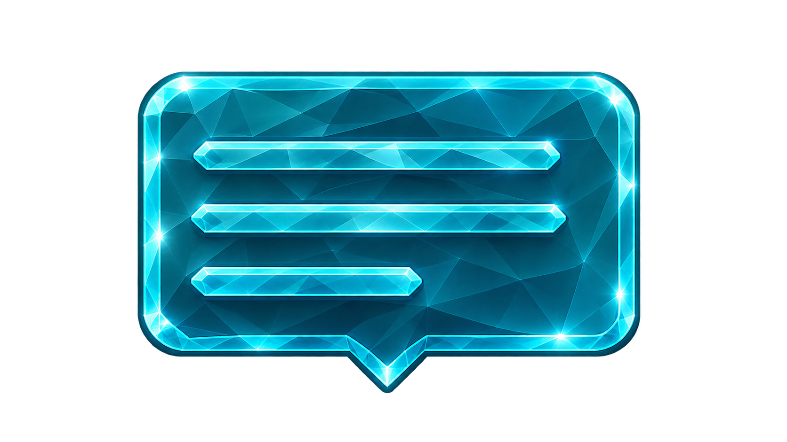

<div align="center">

  # Tooltip

  ### Custom layered tooltips for Lua

  <br>
  <br>


  

</div>


## Summary

<details>

<summary><ins>Table of contents</ins></summary>

- [Overview](#overview)
  - [Colors and Units](#beginner-colors-and-units)
  - [Merging Options](#beginner-merging-options)
- [Features](#green_book-features)
- [Quick Example](#jigsaw-quick-example)
- [Module `tooltip`](#book-module-tooltip)
  - [Method `tooltip()`](#large_orange_diamond-method-tooltip)
  - [Options](#large_orange_diamond-options)
  - [Method `tt:update()`](#large_orange_diamond-method-ttupdate)
  - [Method `tt:destroy()`](#large_orange_diamond-method-ttdestroy)
  - [Method `tt:show()`](#large_orange_diamond-method-ttshow)
  - [Method `tt:hide()`](#large_orange_diamond-method-tthide)
  - [Method `tt:move()`](#large_orange_diamond-method-ttmove)
  - [Method `tt:isVisible()`](#large_orange_diamond-method-ttisvisible)
  - [Method `tt:hwnd()`](#large_orange_diamond-method-tthwnd)
- [Links](#paperclip-links)
- [License](#scroll-license)

</details>

<br>
<br>


## Overview

Tooltip is a lightweight and fully customizable tooltip module for [**RainJIT**](https://github.com/F4Jonatas/RainJIT). Each tooltip is a per-pixel-alpha **layered window** drawn with [**Direct2D**](https://learn.microsoft.com/en-us/windows/win32/direct2d/direct2d-portal) and [**DirectWrite**](https://learn.microsoft.com/en-us/windows/win32/directwrite/direct-write-portal), so it supports rounded corners, gradients, borders, icons, images, color emoji and system backdrop materials (acrylic and mica).<br>

The bitmap is drawn **only when the content or the style changes**. Moving a tooltip never redraws it, which keeps the cost of a tooltip that follows the mouse close to zero.

A tooltip is composed of up to three blocks, stacked from top to bottom:

- **Title row** — optional icon followed by the title
- **Image** — optional picture
- **Text** — optional body text

<br>


### :beginner: Colors and Units

- **Colors** are numbers in the `0xRRGGBBAA` format, e.g. `0xFF0000FF` is opaque red and `0x00000080` is 50% transparent black. Negative values produced by the LuaJIT `bit` library are accepted.
- **Sizes** (margins, radius, icon size, image size, offsets, `maxWidth`) are expressed in logical pixels at 96 DPI and are scaled automatically by the DPI of the monitor where the tooltip is displayed.
- **Font sizes** are expressed in points.
- **Strings** are UTF-8.
- **Paths** (`icon` and `image`) must be absolute.

<br>


### :beginner: Merging Options

The `options` table is **merged** with the previous options, so only the keys present in the table are changed:

- A missing key (or `nil`) keeps the current value.
- `false` removes optional entries: `x`, `y`, `title`, `titleFont`, `titleColor`, `icon`, `image`, `timeout`, `fadeDuration`, `backdrop` and `backdropTint`.
- An invalid value raises a Lua error describing the offending option.

<br>


## :green_book: Features

- Per-pixel alpha, anti-aliased rendering with Direct2D / DirectWrite
- Color emoji and automatic system font fallback
- Fade-in / fade-out animation with `fadeDuration`
- Redraws only when the content or the style changes; moving never redraws
- Content-sized bitmap, with no full-screen buffers
- Title with optional icon, body text and image blocks
- Solid or gradient background, rounded corners, border and margins
- Text wrapping with `maxWidth` and left, center or right alignment
- Per-monitor DPI scaling
- Follows the cursor (with screen-edge flipping) or stays at a fixed screen position
- Optional auto-hide `timeout`
- Non-activating and click-through window
- Backdrop materials: `acrylic` (Windows 10 1803+), `mica` and `micaAlt` (Windows 11 22H2+)
- The window is released by `destroy()` or by the Lua garbage collector
- Unknown option keys are reported in the Rainmeter log
- Full UTF-8 support

<br>
<br>


## :jigsaw: Quick Example

**Creating a tooltip only needs the text. By default it appears next to the cursor.**<br>
**To do so, the easiest way is to use the method [`tooltip`](#large_orange_diamond-method-tooltip) of the Lua API.**

```lua
-- @see https://github.com/F4Jonatas/RainJIT#large_orange_diamond-method-import
local tooltip = import("tooltip")

local tt = tooltip("Hello, world!")
```


**All options are optional. The following code creates a styled tooltip that hides itself after 3 seconds.**

```lua
-- @see https://github.com/F4Jonatas/RainJIT#large_orange_diamond-method-import
local tooltip = import("tooltip")

local tt = tooltip("The file was saved.", {
  title           = "Done",
  titleColor      = 0x7CFC00FF,
  backgroundColor = { 0x202020F0, 0x404040F0, 90 },
  borderColor     = 0x808080FF,
  radius          = 8,
  margin          = { 12, 8, 12, 8 },
  timeout         = 3000,
})
```


**Text accepts any Unicode character, including color emoji. `fadeDuration` animates the show, the hide and the `timeout`.**

```lua
local tt = tooltip("Backup finished ✅ 🎉", {
  title        = "Backup",
  timeout      = 2500,
  fadeDuration = 200,
})
```


**An existing tooltip is changed with [`update`](#large_orange_diamond-method-ttupdate) and released with [`destroy`](#large_orange_diamond-method-ttdestroy).**

```lua
tt:update("Saving...")
tt:update(nil, { x = 100, y = 100 }) -- only moves
tt:destroy( 200 )                    -- fades out, then destroys
```

> [!WARNING]
> Keep a reference to the returned object. When it is garbage collected, the tooltip window is destroyed.

---

<br>
<br>


## :book: Module `tooltip`

### :large_orange_diamond: Method `tooltip()`

This method creates a new tooltip and shows it immediately.<br>
If the options are invalid or the window cannot be created, the method raises an error.

The text may be omitted (`nil`) when the tooltip only shows an image.

```lua
-- @usage tooltip(text [, options])
-- @param (string|number|nil|false) text - Body text
-- @param (table) [options] - Options table, see Options
-- @return (userdata) Tooltip instance

local tt = tooltip("Text")
local tt2 = tooltip("Text", { title = "Title", timeout = 2000 })
local tt3 = tooltip(nil, { image = "C:\\images\\photo.png", imageWidth = 160 })
```

<br>


### :large_orange_diamond: Options

All options are optional.

**Placement**

- **x**, **y** (`number|false`) Absolute screen position. When omitted, the tooltip follows the cursor. Use `false` to follow the cursor again.
- **offsetX**, **offsetY** (`number`, default `16`) Distance from the cursor. Used only when following the cursor.

> [!NOTE]
> The tooltip is flipped to the other side of the cursor when it would leave the screen, and is always clamped to the work area of its monitor.

**Text**

- **font** (`string`, default `"Segoe UI"`) Font family. Falls back to `"Segoe UI"` if it is not installed. Characters missing in the font (symbols, CJK, emoji) are drawn with the system font fallback, and color emoji are drawn in color.
- **fontSize** (`number`, default `12`) Font size in points.
- **fontStyle** (`string`, default `"regular"`) Any combination of `regular`, `bold`, `italic`, `underline` and `strikeout`, e.g. `"bold italic"`.
- **textColor** (`number`, default `0xFFFFFFFF`) Text color.
- **align** (`string`, default `"left"`) Alignment of the blocks: `"left"`, `"center"` or `"right"`.
- **maxWidth** (`number`, default `0`) Maximum outer width, margins included. `0` disables wrapping.

**Title and icon**

- **title** (`string|false`) Title shown above the text.
- **titleFont** (`string|false`) Title font family. Defaults to `font`.
- **titleFontSize** (`number`, default `0`) Title font size in points. `0` uses `fontSize + 1`.
- **titleFontStyle** (`string`, default `"bold"`) Same values as `fontStyle`.
- **titleColor** (`number|false`) Title color. Defaults to `textColor`.
- **icon** (`string|false`) Absolute path of an icon image. Shown only when a title exists.
- **iconSize** (`number`, default `16`) Icon width and height.
- **iconGap** (`number`, default `6`) Space between the icon and the title.

**Image**

- **image** (`string|false`) Absolute path of an image. PNG, JPG, BMP, GIF (first frame) and ICO are supported. The file is copied and never kept locked.
- **imageWidth**, **imageHeight** (`number`, default `0`) Image size. `0` keeps the original size. When only one of them is set, the aspect ratio is preserved.
- **imageOpacity** (`number`, default `255`) Image opacity from `0` to `255`.

**Box**

- **backgroundColor** (`number|table`, default `0x202020E0`) A color, or a gradient `{ color1, color2 [, angle] }`. The default angle is `90`.
- **borderColor** (`number`, default `0x606060FF`) Border color.
- **borderWidth** (`number`, default `1`) Border width. `0` disables the border.
- **radius** (`number`, default `6`) Corner radius.
- **margin** (`number|table`, default `8`) Inner spacing. A number applies to all sides, or use `{ left, top, right, bottom }`.

**Window**

- **opacity** (`number`, default `255`) Opacity of the whole tooltip from `0` to `255`.
- **timeout** (`number|false`, default `0`) Time in milliseconds before the tooltip hides itself. `0` or `false` disables it.
- **fadeDuration** (`number|false`, default `0`) Fade time in milliseconds used by the show, hide and `timeout` animations. `0` or `false` disables it. Fading only changes the window opacity, so the bitmap is never redrawn.
- **topmost** (`boolean`, default `true`) Keeps the tooltip above other windows.
- **clickThrough** (`boolean`, default `true`) Lets mouse input pass through the tooltip.

**Backdrop** (`acrylic`: Windows 10 1803 or newer; `mica` and `micaAlt`: Windows 11 22H2 or newer)

- **backdrop** (`string|false`) Material applied behind the tooltip: `"acrylic"`, `"mica"`, `"micaAlt"` or `"none"`. Use `false` to remove it.
- **backdropCorner** (`string`, default `"default"`) Corner style used by the system: `"round"`, `"small"`, `"none"` or `"default"`.
- **dark** (`boolean|string`) `true` forces the dark variant, `false` forces the light one and `"auto"` follows the system theme (default). It mainly affects `mica` and `micaAlt`.
- **backdropTint** (`number|false`) Acrylic tint `0xRRGGBBAA`. When omitted, it follows `dark`. The alpha is the tint strength.

> [!NOTE]
> - Acrylic is applied with `SetWindowCompositionAttribute`, so it stays blurred while the tooltip is not the active window.
> - The material is visible only where the background is translucent. Use a low alpha in `backgroundColor`, e.g. `0x20202040`.
> - While a backdrop is active, the system border is removed, so only the tooltip's own `borderColor` and `borderWidth` are visible. The system only rounds the corners.
> - While a backdrop is active, the drawn corner follows `backdropCorner` (`round` and `default` = 8, `small` = 4, `none` = 0) instead of `radius`, so the drawn shape matches the shape clipped by the system.
> - On older systems the backdrop options are ignored and a warning is written to the Rainmeter log. The final result may vary depending on the Windows build.
> - `mica` and `micaAlt` are best-effort on a layered window and may fall back to a flat color on some builds.

```lua
local tt = tooltip("Acrylic", {
  backdrop        = "acrylic",
  backdropCorner  = "round",
  dark            = true,
  backgroundColor = 0x20202040,
})
```

<br>


### :large_orange_diamond: Method `tt:update()`

This method changes the text and/or the options of a tooltip and **makes it visible**.<br>
The options are merged with the previous ones. The bitmap is redrawn only when something visual changed; a pure position change only moves the window.

```lua
-- @usage tt:update(text [, options])
-- @param (string|number|nil|false) text - nil keeps the text, false clears it
-- @param (table) [options] - Options table, see Options
-- @return (nil)

local tt = tooltip("First")

tt:update("Second")                        -- changes the text
tt:update(nil, { x = 100, y = 100 })       -- only moves
tt:update(nil, { title = false })          -- removes the title
tt:update(nil, { x = false, y = false })   -- follows the cursor again
```

<br>


### :large_orange_diamond: Method `tt:destroy()`

This method destroys the tooltip window and releases all of its resources. It can be called more than once.<br>
Without an argument the tooltip is destroyed at once. With a fade duration it fades out first; calling `show` or `update` during the fade cancels the destruction.<br>
After it, every method except `destroy`, `isVisible` and `hwnd` raises an error.

```lua
-- @usage tt:destroy([fadeDuration])
-- @param (number|nil|false) [fadeDuration] - Fade-out time in milliseconds
-- @return (nil)

local tt = tooltip("Bye")
tt:destroy()        -- immediate

local tt2 = tooltip("Bye")
tt2:destroy( 200 )  -- fades out for 200 ms
```

<br>


### :large_orange_diamond: Method `tt:show()`

This method shows the tooltip again (with a fade-in when `fadeDuration` is set) and restarts the auto-hide timer.

```lua
-- @usage tt:show()
-- @return (nil)

local tt = tooltip("Hello", { timeout = 2000 })

-- after it hides itself
tt:show()
```

<br>


### :large_orange_diamond: Method `tt:hide()`

This method hides the tooltip without destroying it. It fades out when `fadeDuration` is set.

```lua
-- @usage tt:hide()
-- @return (nil)

tt:hide()
```

<br>


### :large_orange_diamond: Method `tt:move()`

This method moves the tooltip to an absolute screen position without redrawing it.<br>
To follow the cursor again, use `tt:update(nil, { x = false, y = false })`.

```lua
-- @usage tt:move(x, y)
-- @param (number) x - Screen X
-- @param (number) y - Screen Y
-- @return (nil)

tt:move(200, 120)
```

<br>


### :large_orange_diamond: Method `tt:isVisible()`

This method returns `true` if the tooltip is currently visible, including while it is fading out. It returns `false` after the tooltip was hidden, was hidden by `timeout` or was destroyed.

```lua
-- @usage tt:isVisible()
-- @return (boolean)

if tt:isVisible() then
  tt:hide()
end
```

<br>


### :large_orange_diamond: Method `tt:hwnd()`

This method returns the native window handle of the tooltip, or `nil` if it was destroyed.

```lua
-- @usage tt:hwnd()
-- @return (number|nil) Window handle

print( tt:hwnd() )
```

---

<br>
<br>


## :paperclip: Links

- [**BeautifulToolTip** — AutoHotkey tooltip that inspired this module](https://github.com/telppa/BeautifulToolTip)
- [**Color font support (DirectWrite / Direct2D)**](https://learn.microsoft.com/en-us/windows/win32/DirectWrite/color-fonts)
- [**Layered Windows**](https://learn.microsoft.com/en-us/windows/win32/winmsg/window-features#layered-windows)
- [**UpdateLayeredWindow**](https://learn.microsoft.com/en-us/windows/win32/api/winuser/nf-winuser-updatelayeredwindow)
- [**DWM_SYSTEMBACKDROP_TYPE**](https://learn.microsoft.com/en-us/windows/win32/api/dwmapi/ne-dwmapi-dwm_systembackdrop_type)
- [**DWMWINDOWATTRIBUTE**](https://learn.microsoft.com/en-us/windows/win32/api/dwmapi/ne-dwmapi-dwmwindowattribute)

---

<br>
<br>


## :scroll: License

Licensed under the **GPL v2.0 License**.<br>

> [!NOTE]
> Tooltip relies on the Windows Direct2D, DirectWrite, GDI+ (image decoding) and DWM system components, which are provided by the operating system and are not redistributed.

---

<br>
<br>


<div align="center">
  For more information, visit the <b><a href="../../README.md">RainJIT documentation</a></b>
</div>

<br>
<br>
